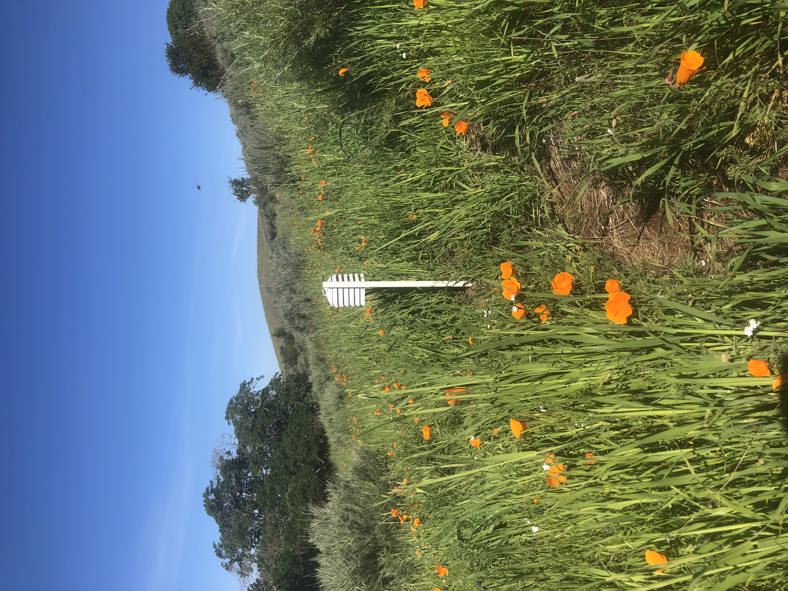
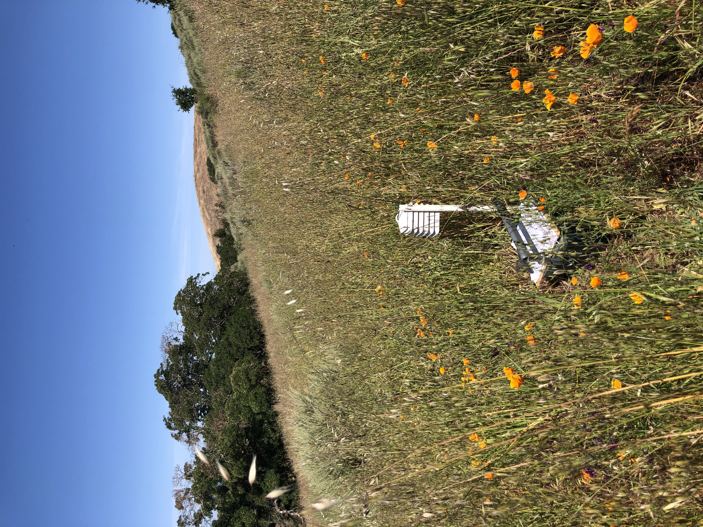
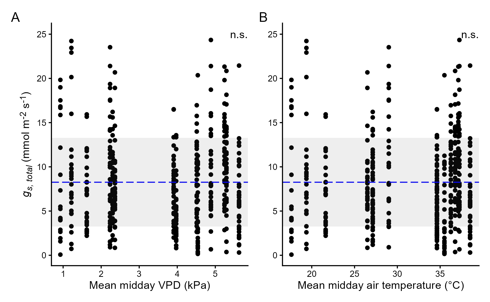
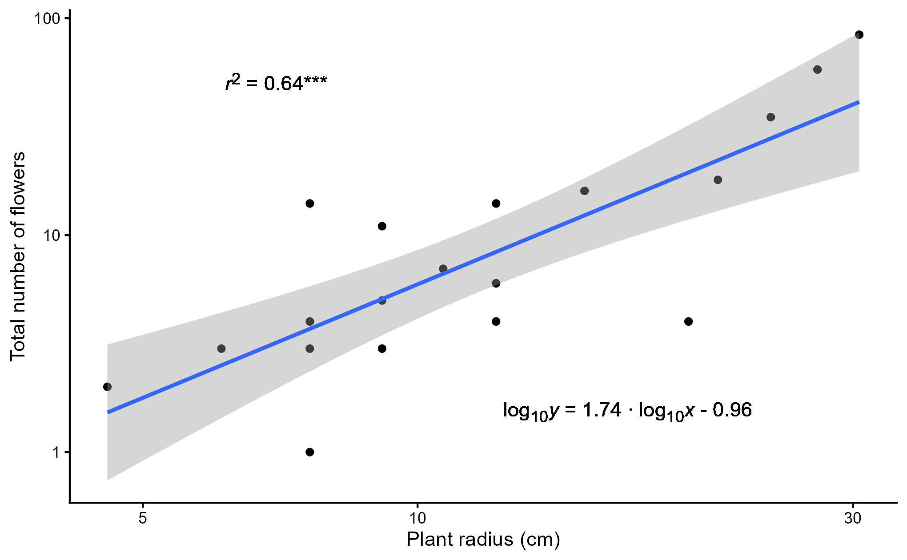
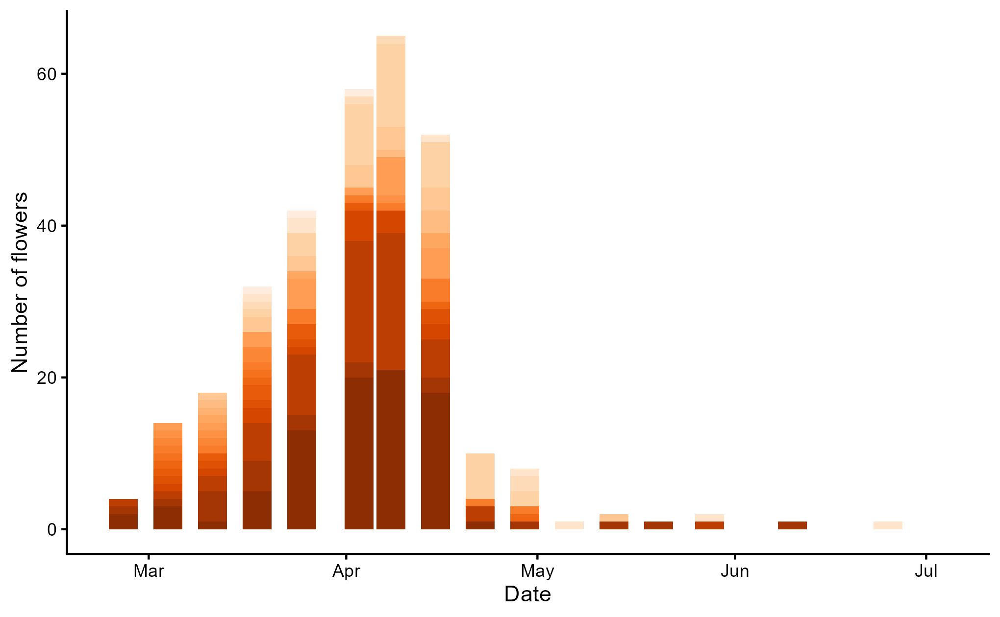

# Introduction

Flower production is key to the reproductive success of animal-pollinated plants. In these species, the reliance on attracting animal pollinators means that pollinator selection can greatly influence variation in flower structure and function (Bell 1985; Teixido *et al.* 2016). However, water availability can counter pollinator-mediated selection on floral traits by constraining the size, color, and nectar volume of flowers (Galen 1999; Caruso *et al.* 2019; Strauss and Whittall 2006). Flowering plants in many habitats face exceptional water shortages that will challenge reproduction, as droughts are currently increasing in frequency due to human-caused climate change (Dai 2013; IPCC 2023). Understanding the water cost of flowering may help us predict how plant reproduction will respond to future drought.

Water is important for the construction and maintenance of flowers. Flower petals have a relatively high water construction cost due to a low dry matter content in comparison to leaves. This greater floral water construction cost is caused by flower petals relying on turgor pressure for biomechanical support rather than carbon-dense cell walls (Roddy et al., 2019; Roddy et al., 2023). In contrast, the amount of water needed to replace evaporative water loss in order to prevent dehydration—the water maintenance cost—is generally low compared to leaves. This lower floral water maintenance cost is because, for many species, petal stomata are sparse or all together absent (Lipayeva 1989; Zhang *et al.* 2018; Roddy *et al.* 2016). As such, petal water loss is largely associated with cuticular water loss, which has a relatively low surface conductance to water vapor, or *g~s~* (Aun *et al.* 2024; Feild *et al.* 2009; Roddy *et al.* 2018). The combination of low carbon investment, high water content, and low *g~s~* implies a strategy that diminishes the overall resource cost of building and maintaining flowers in comparison with leaves (Roddy *et al.* 2016). The evolution of this low carbon investment strategy in angiosperms is likely a consequence of water being a relatively cheaper resource than carbon for maintaining the shape of short-lived, heterotrophic structures like flowers (Ashman and Schoen 1994; Roddy *et al.* 2021).

A strong reliance on water for flowering outlines certain risks to reproductive failure in a changing climate (Aun *et al.* 2024; Zhang and Brodribb 2017; Carins-Murphy *et al.* 2023; Bourbia *et al.* 2020). While reducing stomata density may lower petal *g~s~*, this comes with the tradeoff of reduced control over water loss. In fact, flowers lose more water than leaves during intervals of enhanced atmospheric demand and soil water stress that result in stomatal closure (Roddy *et al.* 2023). In comparison with leaves, flowers experience greater change in water content per change in water potential, or hydraulic capacitance, which apparently compensates for their relative inability to downregulate transpiration (An *et al.* 2023; Roddy *et al.* 2019). In spite of this, flowers have shown greater potential for turgor loss than leaves, and the wilting of petals can affect reproduction by obstructing sexual organs from pollinator access (Aun *et al.* 2024). Furthermore, the sizeable influence of cuticular conductance in petals means that flowers exposed to extreme heat may be vulnerable to structural changes in the cuticle that accelerate water loss (Aun *et al.* 2024; Schreiber and Schönherr 1990).

Maintaining conspicuous floral display poses additional problems for plants flowering through drought. The water maintenance cost of larger flowers increases in drought-prone environments due to their greater evaporative surface area (Teixido and Valladares 2014; Lambrecht 2013; Galen *et al.* 1999). Large flowers also have a higher water construction cost because they contain more tissue volume to hydrate (Paiva and Roddy 2024). Reductions in flower size under water limitation can occur via developmental plasticity, which may decrease floral construction cost as well as reduce total potential water loss (Caruso 2006; Lambrecht *et al.* 2017; Matesanz *et al.* 2010). Although smaller flowers may reduce floral water demand, reductions in flower size under drought are not necessarily adaptive because they often occur alongside declines in flower number, pollinator attraction, and reproductive output (Kuppler and Kotowska 2021; Gallagher and Campbell 2017; Höfer *et al.* 2023; Bonser 2021). Reductions in flower size may impact pollinator-visitation because pollinators prefer conspicuous flowers that tend to produce more rewards like nectar (Gervasi and Schiestl 2017; Nattero *et al.* 2010; Schemske and Bradshaw 1999).

Declines in flower size within seasonally dry climates caused by either plasticity to water limitation or plant ontogeny may alleviate the water cost of flowering for plants blooming through drought (Lambrecht and Dawson 2007; Weiner 2004). Phenotypic plasticity in bud diameter, total floral biomass, and number of seed capsules is well documented in *Eschscholzia californica* Cham. (Papaveraceae), with much of the flexibility in their development seemingly linked with variation in the abiotic environment (Becker *et al.* 2005; Bustamante *et al.* 2017; Leger and Rice 2003). In their native range in California, *E. californica* typically flower from February to September (Greenhouse *et al.* 2012), but flowering onset is advancing in some locations due to increasing mean annual temperatures (Pearson *et al.* 2021). The long bloom period of *E. californica* corresponds with the transition to dry-summer in a Mediterranean climate, when water availability decreases and atmospheric water demand increases. Flower size reduction may minimize the water cost of flowering in *E. californica* across its bloom period. Mechanistically, this could be accomplished by developmental plasticity, but making this claim requires us to test for ontogenetic contingency (Diggle 1997). In this study, we evaluated the influence of ontogeny and phenotypic plasticity on floral water use in a wild *E. californica* population from Northern California. Specifically, we characterized changes in the water construction and maintenance costs of flowering by tracking petal area, water content, *g~s~*, and flower number alongside seasonal shifts in vapor pressure deficit (VPD). To separate out an ontogenetic effect, we measured the same floral water use traits with plants grown in the controlled environment of a greenhouse.

# Methods

## Study system

*Eschscholzia californica* Cham. is an annual or perennial in the family Papaveraceae native to the west coast of North America and introduced to Chile, New Zealand, Tasmania, and Australia. *Eschscholzia californica* produce a determinate inflorescence composed of orange-yellow flowers. The corolla is biseriate and polypetalous, in which four wedge-shaped petals are arranged opposite one another. The flowers are bisexual, self-incompatible, nectarless, and predominantly pollinated by bees and beetles (Cook 1962; Anic *et al.* 2015). Individual flowers remain open for up to four days before the petals and stamens abscise (Becker *et al.* 2005). In their California range, *E. californica* can flower from January to September in open grasslands, and they are often found alongside other wildflower species.

We conducted a field study between February and June of 2025 in the San Francisco Bay Area of California at a single site in Mount Diablo State Park (37°52'57.6"N 121°58'12.2"W). The site is an open grassland with a dense stand of *Eschscholzia californica* on a south-facing hillside (Figure 1). A regional weather station at nearby Diablo Junction records average maximum temperatures of 30 °C in July, average minimum temperatures of 3.9 °C in January, and 612 mm of mean annual precipitation (Hutton *et al.* 2021). The soil was weathered from metamorphosed sandstone and shale of the Franciscan Formation. Chaparral vegetation consisting of *Artemisia californica* and *Salvia mellifera* shrubs on a chert outcrop occur uphill from the study area. Invasive, non-native grasses such as *Avena barbata* are common.

::: {#fig-site}
{#fig-march fig-alt="A green, grassy hillside with bright orange poppy flowers on a cloudless, sunny day. In the center of the image is a white, knee-high post with small solar radiation shield hanging from the top."}

{#fig-april fig-alt="The same scene as before, except now the grass on the hillside is taller and has turned brown. Poppies still grow, expect they appear smaller and yellowish in color."}

Photographs from the Mount Diablo field site. On March 25th, 2025, fresh *Avena barbata* growth is green and *Eschscholzia californica* flowers are large and bright orange. On April 29th, 2025, mature *A. barbata* are taller and turning brown, but *E. californica* flowers are still blooming.
:::

Microclimate was recorded during the study period using a temperature (°C) and relative humidity (%) sensor (Lascar EL-USB-2 data logger) housed in a solar radiation shield and placed 1 meter above the ground at the site coordinates. Air temperature and relative humidity were recorded every 30 minutes. Vapor pressure deficit (VPD; kPa)—a measure of the atmospheric demand for water from leaves and petals—was calculated from air temperature and relative humidity using the Arden Buck equation (Buck 1981). Some microclimate data were lost due to equipment malfunctions. Specifically, data were absent from the periods between February 14 – March 4, March 25 – April 8, and April 15 – April 22. To gap fill this missing microclimate data, PRISM minimum, mean, and maximum air temperature and VPD for our site coordinates were used to develop linear models between PRISM data and site microclimate data (PRISM Group 2025). These linear models were used to predict daily minimum, mean, and maxiumum VPD and air temperature during the time series gaps in the sensor data (see Supplemental Figure S1 and Supplemental Table S1).

## Flower measurements

We measured petal traits between 9:00 am and 2:00 pm PST during peak daytime temperatures when flowers were open. To evaluate the relationship between seasonal climate and reproductive water cost in *E. californica*, we recorded three different floral water use traits in the field—petal surface conductance (*g~s~*), petal area, and petal water content. We also recorded the number of flowers produced by 20 *E. californica* plants at the Mount Diablo study site to provide insight into whole plant reproductive investment. Between February 25^th^ and March 18^th^, we selected adult plants within 15 m of the site coordinates. Selected plants were spaced at least 5 m apart to ensure an even distribution of plants across the study plot. We marked each plant with blue flagging tape tied loosely around the central stem, and we drove a small stake into the ground adjacent to the plant to use as a backup marker. Only flowering plants were chosen to eliminate non-reproducing individuals. As such, flower counts likely overestimate the mean flower production from the total population due to an unknown number of non-flowering plants. For the duration of the study period, we counted the flowers on each flagged plant once every 5 to 8 days. Flower pedicels were marked with indelible ink to avoid double counting. We did not count flowers that were open between field visits. Therefore, our flower counts are an underestimate of total flower production from the selected plants. On April 22^nd^ after flower counts began to decline (Figure S2), the longest rosette leaves on the flagged *E. californica* were measured to determine plant radius (m). This data was then used to evaluate the influence of plant size on total individual flower production up to April 22^nd^.

We recorded the surface conductance to water vapor, *g~s~* (mmol m^-2^ s^-1^), from two undamaged petals of a fully-expanded flower on each flagged plant using a portable steady-state porometer (Model LI-600, LI-COR Environmental, Lincoln, NE, USA). Petal surface conductance was measured on both the adaxial and abaxial surfaces (*g~s~*~, *adaxial*~ and *g~s, abaxial~*, respectively). Values for *g~s, abaxial~* and *g~s, adaxial~* from individual flowers were added together to get total petal surface conductance (*g~s, total~*). Low rates of water loss can be hard to resolve given the ± 2% accuracy of the relative humidity sensors and ± 0.5 °C accuracy for surface temperature measurements of the LI-600 (LI-COR 2026). To correct for instrument accuracy, we set any negative *g~s~*~, *adaxial*~ and *g~s~*~, *abaxial*~ values to 0 mmol m^-2^ s^-1^. Out of 1842 *g~s~*~, *adaxial*~ and *g~s~*~, *abaxial*~ values, 442 were less than 0 mmol m^-2^ s^-1^. Previous research monitoring the change in the fresh mass of detached petals through time has shown that *g~s, total~* for *E. californica* is around 11.3 mmol m^-2^ s^-1^ (Roddy *et al.* 2023). In light of this information, we eliminated *g~s, total~* values greater than 25 mmol m^-2^s^-1^, which is twice the previously reported values for *E. californica*. Out of 921 measurements of *g~s, total~*, 77 values were greater than 25 mmol m^-2^s^-1^. These anomolous readings were likely due to damaged petal surfaces or residual petal surface moisture from dew. 76 measurements of *g~s, total~* were 0 mmol m^-2^ s^-1^, meaning the *g~s~*~, *adaxial*~ and *g~s~*~, *abaxial*~ values were both negative. These were also excluded, as it is highly unlikely for living petal tissue to have negative *g~s, total~*. Altogether, this left us with a sample size of 768 *g~s, total~* measurements.

Petal projected area (*A~petal~*; m^2^) and absolute petal water content (*W~absolute~*; mg) were evaluated on 20 additional *E. californica* plants each week when possible. Five individuals were sampled at the study site on February 25^th^, 10 were sampled on March 4^th^, and 14 on March 11^th^. Fewer plants were observed flowering in late February and early March. As such, initial sample sizes for flower measurements taken earlier in the season were small, but they increased with time. Plants were initially selected haphazardly and then randomly chosen on a 30 m x 30 m grid centered at the site coordinates after May 5^th^~.~ We excluded flagged plants from petal collection to prevent damage that may have impacted floral output. Before petal excision, the *g~s~*~, *adaxial*~ and *g~s~*~, *abaxial*~ of the flower were measured in the previously described manner. One flower petal was harvested per plant. Each petal was sealed in a plastic bag alongside a moist paper towel in an ice chest before transportation to the laboratory. On the same day, excised petals were carefully unfolded and photographed on a white sheet to assess their projected area (Schneider *et al.* 2012). To minimize the amount of flower material removed from the *E. californica* population at Mt. Diablo, *A~petal~* values were multiplied by 4 to estimate total open flower projected area (*A~flower~*). After scanning for *A~petal~*, we weighed the harvested petals to obtain their fresh mass before oven-drying them at 70 °C for at least 48 hours to obtain their dry mass. These were used to compute *W~absolute~* (fresh mass – dry mass)*.*

## Greenhouse study

We performed a greenhouse study between September 2025 and January 2026 to investigate the effect of ontogeny on flower size. We collected seed from multiple plants on the Mount Diablo study plot between the months of May and June. We adapted our germination methods from those used by Montalvo *et al.* (2002). Seeds were placed in petri dishes between two filter papers and wetted with 2 ml of water. The seeds were subjected to cold stratification in a 6—8 °C refrigerator. Petri dishes were checked every few days, and remoistened with 2 ml of water if the filter paper was dry. We observed germination after 21 days. All seeds were promptly transplanted to 11.5-L pots in the greenhouse at San Francisco State University.

We grew 12 plants in sandy loam with added organic matter. Plants were under natural light supplemented with 15 hours of overhead lighting to induce flowering and accelerate growth (Sharma and Nanda 1976). For the temperature range, we chose to approximate springtime conditions at the Mount Diablo field site. Daytime temperatures were regulated between 16—24 °C, whereas nighttime temperatures were maintained between 4—10 °C. Relative humidity was allowed to fluctuate with the exterior climate. We placed a temperature and relative humidity sensor (Lascar EL-USB-2 data logger) approximately 1 meter above the growing table to monitor greenhouse air temperature and VPD. To ensure plants were well-watered, we initially watered every 3 to 4 days until the top 5 cm of soil in each pot was wet to touch. We eventually found it necessary to increase watering frequency over time to accommodate growing plant size. As such, an automatic irrigation system was built on December 17^th^, after which plants were watered for 5 minutes once every 24 hours.

We began floral measurements when flowering was observed after 5 weeks of growth. The week when flowering began for each individual plant was recorded, and floral measurements were made every 5 to 8 days. Values for *g~s, total~*, *A~petal~*, and *W~absolute~* were measured with the same methods described previously, but with one difference. We measured the *g~s~*~, *adaxial*~and *g~s, abaxial~* of three flowers per plant, including the collected flower petal. After determining *g~s, total~* for each flower, we calculated mean *g~s, total~* for each plant per week.

## Whole flower water use

Whole flower midday water use (*E~flower~*;mmol s^-1^) was calculated as the ratio of mean midday vapor pressure deficit (VPD~midday~; kPa) per standard atmospheric pressure (101.3 kPa) multiplied by total petal surface conductance (*g~s, total~*; mmol m^-2^ s^-1^) and open flower projected area (*A~flower~*; m^2^).

$E \scriptstyle flower$ = $\frac{VPD midday}{101.3}$ ∗ $g \scriptstyle s, total$ ∗ $A \scriptstyle flower$

As *E. californica* flowers close at night, we chose midday as our window of time to ensure that our model accounted for nyctinasty (Simonin et al., pending publication). We defined midday as the 2-hour duration between 11:00 am and 1:00 pm PST. Mean VPD was calculated for the midday time duration from the available field sensor data. Midday VPD data were missing from March 25 and April 15, so we used values from the day prior because they were the best approximates according to regional weather records (PRISM Group 2025, Figure 2). Due to the lack of wind speed data, we ignored surface boundary layer conditions in our flower water loss model.

## Statistical methods

All statistical analyses were performed in R (v4.4.1; R Core Team 2024). We used two separate one-way analysis of variance (ANOVA) with the *stats* package to test whether *A~petal~* and *W~absolute~* differed among weekly sampling periods during the seasonal transition from spring to summer. We visualized and tested ANOVA model residuals using Q-Q plots, the Shapiro-Wilk normality test, and Bartlett’s test for homoscedasticity. The data for *A~petal~* and *W~absolute~* were log~10~-transformed when necessary, so that model assumptions were met. For traits exhibiting significant differences among weeks (*p* \< 0.05), we used the Tukey HSD test to make pairwise comparisons between each weekly batch of flower petals. The coefficients of determination (*r*^2^) were calculated by dividing the group sum of squares by the total sum of squares. The *p*-values were derived from the F-distribution.

To test for relationships between seasonal climate and floral water use traits, we fit linear regression models using flower trait as the dependent variable and a measure of climate as the independent variable. We first looked at two separate regressions with *A~petal~* and *W~absolute~* as functions of maximum VPD (VPD~max~). The data for *A~petal~*, *W~absolute~*, and VPD~max~ were log~10~-transformed for these models, but in the figures the data were plotted in arithmetic space with the regression lines appropriately transformed. We calculated mean VPD~max~ across a 10-day period prior to petal collection. Research into *E. californica* morphogenesis suggests that a 10-day window is appropriate considering the duration of bud development, when flower growth rate variation is pronounced (Becker *et al.* 2005). We also looked at three separate regressions of *g~s, total~* as it related to mean midday temperature, mean midday VPD, and week. To account for non-independence in repeat *g~s, total~* measurements taken from flagged plants, we used the *lme4* package to fit linear mixed effect models (LMMs) with plant as the random effect (Bates *et al.* 2015). P-values were derived from LMMs using the *lmerTest* package (Kuznetsova *et al.* 2017). We applied linear regressions for non-repeat measurements. Additionally, we used linear regressions to analyze whole flower midday water use against *A~petal~*, mean midday VPD, and week. We also used a multiple linear regression (MLR) to test how *A~petal~* and mean midday VPD together predict whole flower midday water use.

We constructed additional models to further describe *E. californica* reproductive physiology. To test for a relationship between plant size and flower production, we fit a linear regression model using the sum total number of flowers produced by flagged plants by April 22^nd^ as the dependent variable and plant radius as the independent variable. Linear regression was also used to test the scaling relationship between *W~absolute~* and *A~petal~*. To test whether water content per dry mass (*W~mass~*, g g^-1^) was changing with petal size, we used linear regression to analyze the scaling relationship of *W~mass~* and *A~petal~*. We log~10~-transformed all data for these regressions, but we visualized the petal data in arithmetic space with the regression lines transformed accordingly.

We analyzed the greenhouse data with linear mixed effects models to account for non-independence caused by repeated sampling across individual plants (Muhammad 2023). We tested how week of flowering predicted *A~petal~*, *W~absolute~*, and *g~s, total~* using plant as the random effect. To assess if response variables met model assumptions, we used the Shapiro-Wilk test and Q-Q plots to determine that the residuals were normally distributed. Estimated marginal means with Tukey adjustment were used to make pairwise comparisons between sampling periods. This was done with the *emmeans* package (Lenth 2023).

# Results

## Climate

Air temperature and VPD increased over the bloom period (February 25 to July 2) at Mount Diablo (Figure 2A, 2C). In March, average daily temperatures were 12.0 ± 2.84 °C, with mean VPD of 0.527 ± 0.248 kPa. By June, average daily temperatures and VPD were 22.7 ± 3.21 °C and 2.16 ± 0.742 kPa, respectively. Greenhouse climate approximated mean conditions recorded in the field during late March – early April. Average temperatures and VPD across the entire greenhouse study were 17.2 ± 1.73 °C and 0.582 ± 0.158 kPa (Figure 2B, 2D).

{fig-alt="Four line graphs showing climate trends on the y-axes and calendar dates on the x-axes. At Mount Diablo, vapor pressure deficit and air temperature tended to increase over time, whereas in the greenhouse these variables were generally stable."}

## Petal area and water content

Both *A~petal~* and *W~absolute~* differed significantly amongst weekly samples at the Mount Diablo field site (Figure 3A and 3C, *p* \< 0.0001). According to Tukey HSD comparisons, petals collected before April 15—the 8th week of the field study—were distinct from any observed after week 10 on April 29 (*p* \< 0.0001). Mean *A~petal~* between February 25 and April 3 (week 1–6, n = 89) was 10.2 ± 3.26 cm^2^, and mean *W~absolute~*was 91.4 ± 32.5 mg. From May 6 to June 25 (week 11–18, n = 140), mean *A~petal~* was 2.72 ± 0.942 cm^2^, and mean *W~absolute~*was 17.2 ± 7.17 mg. Petals collected on April 15 and April 29 (week 8 and 10, n = 40) were transitional, with intermediate size and water content (*A~petal~* = 6.26 ± 2.28 cm^2^, *W~absolute~* = 47.2 ± 21.7 mg). Tukey HSD comparisons indicated that these transitional petals differed from both early and late-season petals for both traits (each *p* \< 0.0001). *A~petal~* and *W~absolute~* negatively declined with 10-day mean VPD~max~ (Figure 4). The relationships were modeled as log~10~*A~petal~* = -1.22 ∙ log~10~VPD~max~ + 1.25 (*r^2^* = 0.73, *p* \< 0.0001) and log~10~*W~absolute~* = -1.55 ∙ log~10~VPD~max~ + 2.27 (*r^2^* = 0.77, *p* \< 0.0001).

{fig-alt="Four boxplot graphs showing petal size and water content on the y-axes and week of field study and week of flowering on the x-axes."}

*A~petal~* and *W~absolute~* varied significantly when observed over the course of development in a greenhouse setting (Figure 3B and 3D, *p* \< 0.0001). Petals were largest during weeks 1–3 of flowering (n = 36). Mean *A~petal~* was 10.2 ± 1.87 cm^2^ and mean *W~absolute~* was 83.9 ± 18.7 mg. By weeks 6–18 of flowering (n = 65), both of the means for *A~petal~* and *W~absolute~* had reduced (*p*\<0.0001) to 6.80 ± 1.65 cm^2^ and 51.0 ± 13.9 mg, respectively. Flowers were transitional during weeks 4 and 5 (n = 24). They were distinct from weeks 6 – 18 in size (*A~petal~* = 8.82 ± 2.70 cm^2^, *p* \< 0.0001) and water content (*W~absolute~* = 67.6 ± 20.4 mg, *p* \< 0.0001), but the comparison to earlier weeks was weaker (*A~petal~*, *p* = 0.0045; *W~absolute~*, *p* = 0.0001).

{fig-alt="Two scatterplots showing petal area and petal water content on the y-axes and 10 day mean VPD max on the x-axes."}

## Petal surface conductance and whole flower water use

{fig-alt="Two scatterplots showing total petal surface conductance on the y-axes and week of field study and week of flowering on the x-axes."}

In contrast to *A~petal~* and *W~absolute~,* *g~s, total~* did not significantly change over the course of time or development. Figure 5A demonstrates that there was no relationship between week and *g~s, total~*at Mount Diablo across the observation period (mean *g~s, total~* = 8.26 ± 5.01 mmol m^-2^ s^-1^). Likewise, *g~s, total~* did not vary significantly across development in greenhouse plants (Figure 5B, mean *g~s, total~* = 6.12 ± 4.69 mmol m^-2^ s^-1^). Furthermore, mean *g~s, total~* in *E. californica* flowers at Mount Diablo was unresponsive to mean midday VPD and air temperature (Figure 6).

{fig-alt="Two scatterplots showing total petal surface conductance on the y-axes and mean midday VPD and mean midday air temperature on the x-axes."}

When we modeled whole flower midday water use, the combination of increasing VPD, decreasing *A~petal~*, and stable *g~s, total~*meant that *E~flower~* remained relatively steady across the seasons at Mount Diablo (Figure 7A; *E~flower~* = -1.50 × 10^-5^*t* + 6.78 × 10^-4^, *r^2^* = 0.03, *p* = 0.019). *E~flower~* was weakly but positively related to VPD (Figure 7B; *E~flower~* = 8.15 × 10^-5^VPD~midday~ + 2.22 × 10^-4^, *r^2^* = 0.09, *p* \< 0.0001). *E~flower~* was positively related to *A~petal~*, but this relationship was also weak (Figure 7C; *E~flower~* = 4.15 × 10^-5^*A~petal~* + 3.08 × 10^-4^, *r^2^* = 0.13, *p* \< 0.0001). A multiple linear regression with *A~petal~*and VPD~midday~ as predictors for *E~flower~* was the best fitting model (*E~flower~* = 7.57 × 10^-5^*A~petal~* + 1.68 × 10^-4^VPD~midday~ - 4.52 × 10^-4^, *r^2^* = 0.42, *p* \< 0.0001).

{fig-alt="Three scatterplots showing whole flower midday water loss on the y-axes and calendar date, mean midday VPD, and petal area on the x-axes."}

## Whole plant flower production and petal scaling relationships

{fig-alt="A scatterplot showing total number of flowers on the y-axis and plant radius in centimeters on the x-axis."}

According to flower count surveys, peak flowering at Mount Diablo was observed on April 8 (Supplemental Figure S2). The flagged plants bloomed seldomly in the months of May and June. Plant radius positively related with the total number of flowers produced by each individual by April 22(Figure 8, log~10~*y* = 1.74 ∙ log~10~*x* - 0.96, *r^2^* = 0.64, *p* \< 0.0001).

{fig-alt="A scatterplot showing petal area on the y-axis and absolute petal water content on the x-axis. Dark blue triangles overlay the light blue circles."}

*A~petal~* at Mount Diablo was strongly predicted by *W~absolute~* in a positive relationship (Figure 9, log~10~*A~petal~* = 0.8 ∙ log~10~*W~absolute~* - 0.55, *r^2^* = 0.99, *p* \< 0.0001). Likewise, there was a significant, non-isometric relationship between *W~mass~* and *A~petal~*~,~ explained by a positive slope (Figure 10, log~10~*W~mass~* = 0.22 ∙ log~10~*A~petal~* + 0.66, *r^2^* = 0.67, *p* \< 0.0001). Data from greenhouse petals were not used in the regression analysis, but they were included in the figures for the purpose of comparison.

{fig-alt="A scatterplot showing water content per dry mass on the y-axis and petal area on the x-axis. Dark blue triangles overlay the light blue circles."}

# Discussion

It is now well recognized that decreasing water availability can have significant impacts on floral traits involved with pollinator attraction, such as petal size (Galen 1999; Kuppler and Kotowska 2021; Powers *et al.* 2022). One reason for this is that flowers require a significant water investment due to their relatively high water content per unit dry mass as compared to leaves (Roddy *et al.* 2023). The water cost of constructing and maintaining flowers is expected to vary greatly for plants with a long bloom period that span distinct wet and dry periods, like *Eschscholzia californica* (Teixido and Valladares 2014; Greenhouse *et al.* 2012). Here we show that changes in floral water cost over a 4-month bloom period for *E. californica* are influenced by a combination of ontogeny and phenotypic plasticity.

## Ontogenetic shifts in the water cost of flowering

We tested for ontogenetic changes in the construction and maintenance cost of flowering by growing *E. californica* from seed under stable environmental conditions that imitated the springtime conditions of the parent population from Mount Diablo (Figure 2). Over an 18-week period the absolute water content of flower petals (*W~absolute~*) decreased by 39%, primarily driven by a 33% decrease in *A~petal~*. Greenhouse petals decreased from an average 10.2 cm^2^ and 83.9 mg of water to 6.8 cm^2^ and 51 mg (Figure 3B and 3D). Although a small decrease was observed in *A~petal~*, we observed no change in petal *g~s~* over the 18-week period of development (Figure 5B). Taken together, it seems ontogeny influenced the water cost of flowering by changing *A~petal~*, but there were apparently no developmental changes in petal *g~s~*.

## Phenotypic plasticity in the water cost of flowering

*A~petal~* in wild plants decreased 73% over the monitored 18-week period at Mount Diablo, and *W~absolute~* at the field site reduced by 81% (Figure 3A, 3C). Wild flowers produced at the beginning of the bloom period were similar in size to those made by greenhouse plants (10.2 cm^2^ and 91.4 mg of water), but in the final weeks *A~petal~* and *W~absolute~* at Mount Diablo decreased to 2.7 cm^2^ and 17.2 mg. The divergence between wild and cultivated plants implies that investment in flowering responded to water availability, as seen in other species (Zhou *et al.* 2025; Lambrecht *et al.* 2017; Caruso 2006). While we did not measure soil water availability at our field site, weather records at Diablo Junction indicate that total precipitation was 9 mm in May and 0 mm in June of 2025 (NOAA 2026). The accompaniment of elevated vapor pressure deficit meant that the soil was likely severely water limited later in the bloom period of the wild plants. This would explain why flower size in wild Mount Diablo *E. californica* was responsive to climate, with both *A~petal~* and *W~absolute~* negatively correlated with increasing atmospheric demand for water (Figure 4). Wild plants were exposed to a much drier environment than their counterparts grown in the greenhouse, and the lack of soil water likely drove a greater reduction in petal size.

Shrinking cell size could be the mechanism behind flower size plasticity in *E. californica.* The positive relationship between *W~mass~* and *A~petal~* demonstrates that petal anatomy was changing alongside size (Figure 10). The reduction in the proportion of water to dry mass implies a decreased fraction of symplastic volume compared to apoplast volume in small petals. This could be achieved by either increased cell wall thickness or decreased cell size. Research on grass leaves has shown that symplastic volume scaled positively with water content per fresh mass ($\frac{fresh mass - dry mass}{freshmass}$ = $\frac{W\scriptstyle mass}{W\scriptstyle mass + 1}$), providing support for cell size as likely responsible for changes in petal size (Garnier and Laurent 1994). Galen *et al.* (1999) suggested that cell size is functionally related to corolla size in *Polemonium viscosum* flowers, and that most change in flower size across development involves hydraulic cell expansion. Decreasing cell size can also occur with increasing cell wall thickness, which is advantageous when water becomes limiting to help maintain biomechanical structure at lower water potentials (Cutler *et al.* 1977). We hypothesize that changing cell size underlies changing *E. californica* petal composition, but microscopic imaging is required to confirm this claim.

### The interaction of petal size and floral water use

*Eschscholzia californica* was capable of regulating the total water allocation to flowering by changing flower size but not through changes in petal surface conductance (Figure 5 and Figure 6). This is likely due to the fact that California poppies lack stomata on these particular organs (Becker *et al.* 2005). When evaluating the influence of petal size on the water construction cost of producing flowers, we observed strong non-isometric scaling between *A~petal~* and *W~absolute~* (Figure 9, coefficient = 0.8), suggesting a diminishing return on flower size with increased water allocation toward flowering. In other words, building a few large flowers results in a greater water construction cost than multiple small blossoms. For example, for a total floral display of 80 cm^2^, two 40 cm^2^ flowers would cost \~ 650 mg whereas four 20 cm^2^ flowers would cost \~ 576 mg of water (Figure 9, see equation). In contrast, because there was no relationship between *A~petal~* and *g~s~*, the influence of petal size on the maintenance cost of flowering is ultimately dependent upon the total number of flowers produced and VPD (Figure 7C).

Previous research has shown strong variation in petal *g~s~* in response to changes in air temperature (Aun *et al.* 2024). However, our field observations showed no impact of air temperature on *g~s~* over the bloom period. Since there was no relationship between air temperature and *g~s~*, it is likely that the observed wild poppies did not experience temperatures high enough to induce changes in cuticle structure that lead to increases in *g~s~* (Aun *et al.* 2024). The warmest field day at Mount Diablo was June 25, 2025. According to sensor data, the maximum air temperature was 39.5 °C, just shy of the range of temperatures known to trigger the aforementioned phase transition in the cuticle membrane for some plant species (Schreiber and Schönherr 1990). A reduction in petal surface conductance due to thickening the cuticle is unlikely for this species, as *g~s~* is important for the cooling of epidermal tissue by latent heat exchange. Such a response to increasing temperatures could run the risk of overheating (Nobel 2009).

While water loss from flower petals slightly decreased over time at Mount Diablo (Figure 7), the relationship between *E~flower~* and sampling week was weakly correlated because floral water use was ultimately controlled by both size and vapor pressure deficit (MLR, *r*^2^ = 0.42). Reducing flower size served to stabilize the water maintenance cost of floral display over the bloom period, as shown by the low correlation between water loss and size (Figure 7C, *r*^2^ = 0.13). At greater VPD, the largest flowers seen in early spring were likely vulnerable to losing more water to the atmosphere than smaller flowers. However, we did not observe this phenomenon because daytime VPD during the month of March was below 3 kPa (Figure 2).

### Insight into whole plant reproductive water investment

Flower count data indicate that poppy plants tended to produce a greater number of flowers in late March and early April, when they were also apt to produce large petals (Supplemental Figure S2). Pollinators may be attracted to large floral displays, which would suggest a mechanism for high flower production with bigger petals when water was plentiful (Rowe *et al.* 2020; Gervasi and Schiestl 2017; Teixido *et al.* 2016). Bigger plants produced disproportionately more flowers by April 22nd (Figure 8, slope = 1.74). These large plants could be older individuals that were recruited during prior growing seasons, as the *E. californica* population at Mount Diablo likely contains perennials (Cook 1962).

# Conclusion

*Eschscholzia californica* is an emerging model organism with the potential for synthesizing scientific inquiry across different fields in plant biology (Becker *et al.* 2023). Here, we use California poppies to observe how plant development intersects with physiology in a natural environment. We support our interpretations with comparisons to plants grown in a greenhouse. Our integration here yielded insights into how *E. californica* reproduction responds to a seasonally drying climate. Results like these provide relevant context for conservation biologists when planning for future drying trends caused by climate change.

During March 2026, a year after we completed this field study, the Diablo Junction weather station recorded just 1 mm total precipitation, down from the period of record average of 86 mm. (NOAA 2026; Western Regional Climate Center 2026). Air temperatures were also elevated to a monthly average maximum of 23 °C, a 53% increase from previous years. Our research suggests that California poppies may be capable of responding to unseasonal droughts of this sort by producing smaller flowers. While reduction in flower size may acommpany a reduction in fitness (Supplemental Figure S2, Ryan and Cleland 2021), recent advances suggest non-adaptive plasticity could assist long-term species survival and enhance directional evolutionary change (Ghalambor *et al.* 2015; Velotta *et al.* 2018; Leonard and Lancaster 2020; Campbell-Staton *et al.* 2021). Our results show that flowers produced later in the season were smaller, contained less water, and lost less water to the atmosphere than large flowers. In increasingly water-limited landscapes, reducing floral water cost could affect whether plants maintain reproduction through drought or abandon flowering altogether.

# References

**An Y-D, Roddy AB, Zhang T-H, Jiang G-F**. **2023**. Hydraulic differences between flowers and leaves are driven primarily by pressure-volume traits and water loss. *Frontiers in Plant Science* **14**: 1130724.

**Anic V, Henríquez CA, Abades SR, Bustamante RO**. **2015**. Number of conspecifics and reproduction in the invasive plant *Eschscholzia californica* (Papaveraceae): is there a pollinator‐mediated Allee effect? *Plant Biology* **17**: 720–727.

**Ashman T-L, Schoen DJ**. **1994**. How long should flowers live? *Nature* **371**: 788–791.

**Aun MA, Farnese F, Loram‐Lourenço L, *et al.*** **2024**. Evidence of combined flower thermal and drought vulnerabilities portends reproductive failure under hotter‐drought conditions. *Plant, Cell & Environment* **47**: 1971–1986.

**Bates D, Mächler M, Bolker B, Walker S**. **2015**. Fitting Linear Mixed-Effects Models Using lme4. *Journal of Statistical Software* **67**: 1–48.

**Becker A, Gleissberg S, Smyth DR**. **2005**. Floral and Vegetative Morphogenesis in California Poppy (*Eschscholzia californica* Cham.). *International Journal of Plant Sciences* **166**: 537–555.

**Becker A, Yamada Y, Sato F**. **2023**. California poppy (*Eschscholzia californica*), the Papaveraceae golden girl model organism for evodevo and specialized metabolism. *Frontiers in Plant Science* **14**: 1084358.

**Bell G**. **1985**. On the function of flowers. *Proceedings of the Royal Society of London. B. Biological Sciences* **224**: 223–265.

**Bonser SP**. **2021**. Misinterpreting the adaptive value of phenotypic plasticity in studies on plant adaptation to new and variable environments. *Plant Biology* **23**: 683–685.

**Bourbia I, Carins‐Murphy MR, Gracie A, Brodribb TJ**. **2020**. Xylem cavitation isolates leaky flowers during water stress in pyrethrum. *New Phytologist* **227**: 146–155.

**Buck AL**. **1981**. New Equations for Computing Vapor Pressure and Enhancement Factor. *Journal of Applied Meteorology and Climatology* **20**: 1527–1532.

**Bustamante RO, Durán AP, Peña-Gómez FT, Véliz D**. **2017**. Genetic and phenotypic variation, dispersal limitation and reproductive success in the invasive herb *Eschscholzia californica* along an elevation gradient in central Chile. *Plant Ecology & Diversity* **10**: 419–429.

**Campbell-Staton SC, Velotta JP, Winchell KM**. **2021**. Selection on adaptive and maladaptive gene expression plasticity during thermal adaptation to urban heat islands. *Nature Communications* **12**: 6195.

**Carins-Murphy MR, Cochard H, Deans RM, Gracie AJ, Brodribb TJ**. **2023**. Combined heat and water stress leads to local xylem failure and tissue damage in pyrethrum flowers. *Plant Physiology* **193**: 356–370.

**Caruso CM**. **2006**. Plasticity of inflorescence traits in *Lobelia siphilitica* (Lobeliaceae) in response to soil water availability. *American Journal of Botany* **93**: 531–538.

**Caruso CM, Eisen KE, Martin RA, Sletvold N**. **2019**. A meta‐analysis of the agents of selection on floral traits. *Evolution* **73**: 4–14.

**Cook SA**. **1962**. Genetic System, Variation, and Adaptation in *Eschscholzia californica*. *Evolution* **16**: 278–299.

**Cutler JM, Rains DW, Loomis RS**. **1977**. The Importance of Cell Size in the Water Relations of Plants. *Physiologia Plantarum* **40**: 255–260.

**Dai A**. **2013**. Increasing drought under global warming in observations and models. *Nature Climate Change* **3**: 52–58.

**Diggle PK**. **1997**. Ontogenetic Contingency and Floral Morphology: The Effects of Architecture and Resource Limitation. *International Journal of Plant Sciences* **158**: S99–S107.

**Feild TS, Chatelet DS, Brodribb TJ**. **2009**. Giant flowers of Southern magnolia are hydrated by the xylem. *Plant Physiology* **150**: 1587–1597.

**Galen C**. **1999**. Why Do Flowers Vary? *BioScience* **49**: 631–640.

**Galen C, Sherry RA, Carroll AB**. **1999**. Are flowers physiological sinks or faucets? Costs and correlates of water use by flowers of *Polemonium viscosum*. *Oecologia* **118**: 461–470.

**Gallagher MK, Campbell DR**. **2017**. Shifts in water availability mediate plant–pollinator interactions. *New Phytologist* **215**: 792–802.

**Garnier E, Laurent G**. **1994**. Leaf anatomy, specific mass and water content in congeneric annual and perennial grass species. *New Phytologist* **128**: 725–736.

**Gervasi DDL, Schiestl FP**. **2017**. Real-time divergent evolution in plants driven by pollinators. *Nature Communications* **8**: 14691.

**Ghalambor CK, Hoke KL, Ruell EW, Fischer EK, Reznick DN, Hughes KA**. **2015**. Non-adaptive plasticity potentiates rapid adaptive evolution of gene expression in nature. *Nature* **525**: 372–375.

**Greenhouse J, Markos S, Moe RL, Simono S, Wetherwax M, Vorobik LA**. **2012**. *The Digital Jepson Manual: Vascular Plants of California, Second Edition, Thoroughly Revised and Expanded*. University of California Press.

**Höfer RJ, Lindner T, Ayasse M, Kuppler J**. **2023**. Reduced seed set under water deficit is driven mainly by reduced flower numbers and not by changes in flower visitations and pollination. *Functional Ecology* **37**: 461–471.

**Hutton D, Game JC, Ludwig KF, Jauregui-Lazo J, Tan BC**. **2021**. A Bryophyte Inventory of Mount Diablo, Contra Costa County, California. *Madroño* **68**.

**IPCC**. **2023**. Summary for policymakers. In: Climate change 2023: synthesis report. A report of the intergovernmental panel on climate change. Contribution of working groups I, II and III to the sixth assessment report of the intergovernmental panel on climate change \[Core Writing Team\].

**Kuppler J, Kotowska MM**. **2021**. A meta‐analysis of responses in floral traits and flower–visitor interactions to water deficit. *Global Change Biology* **27**: 3095–3108.

**Kuznetsova A, Brockhoff PB, Christensen RHB**. **2017**. lmerTest Package: Tests in Linear Mixed Effects Models. *Journal of Statistical Software* **82**: 1–26.

**Lambrecht SC**. **2013**. Floral Water Costs and Size Variation in the Highly Selfing *Leptosiphon bicolor* (Polemoniaceae). *International Journal of Plant Sciences* **174**: 74–84.

**Lambrecht SC, Dawson TE**. **2007**. Correlated variation of floral and leaf traits along a moisture availability gradient. *Oecologia* **151**: 574–583.

**Lambrecht SC, Morrow A, Hussey R**. **2017**. Variation in and adaptive plasticity of flower size and drought-coping traits. *Plant Ecology* **218**: 647–660.

**Leger EA, Rice KJ**. **2003**. Invasive California poppies (*Eschscholzia californica* Cham.) grow larger than native individuals under reduced competition. *Ecology Letters* **6**: 257–264.

**Lenth R**. **2023**. emmeans: Estimated Marginal Means, aka Least-Squares Means. *R package version 1.8.5*.

**Leonard AM, Lancaster LT**. **2020**. Maladaptive plasticity facilitates evolution of thermal tolerance during an experimental range shift. *BMC Evolutionary Biology* **20**: 47.

**LI-COR**. **2026**. *LI-600 \| Operating Instructions*. https://www.licor.com/support/LI-600/manuals.html. 6 May 2026.

**Lipayeva L**. **1989**. On the anatomy of petals in angiosperms. *Botanicheskii Zhurnal* **74**: 826–830.

**Matesanz S, Gianoli E, Valladares F**. **2010**. Global change and the evolution of phenotypic plasticity in plants. *Annals of the New York Academy of Sciences* **1206**: 35–55.

**Montalvo AM, Feist-Alvey LJ, Koehler CE**. **2002**. The effect of fire and cold treatments on seed germination of annual and perennial populations of *Eschscholzia californica* (Papaveraceae) in Southern California. *Madroño* **49**: 207–227.

**Muhammad LN**. **2023**. Guidelines for repeated measures statistical analysis approaches with basic science research considerations. *The Journal of Clinical Investigation* **133**: e171058.

**Nattero J, Cocucci AA, Medel R**. **2010**. Pollinator‐mediated selection in a specialized pollination system: matches and mismatches across populations. *Journal of Evolutionary Biology* **23**: 1957–1968.

**NOAA**. **2026**. *Daily Summaries Station Details: Mount Diablo Junction*. https://www.ncdc.noaa.gov/cdo-web/datasets/GHCND/stations/GHCND:USC00045915/detail. 30 Mar. 2026.

**Nobel PS**. **2009**. *Physicochemical and Environmental Plant Physiology*. Academic Press.

**Paiva DC, Roddy AB**. **2024**. Flower longevity and size are coordinated with ecophysiological traits in a tropical montane ecosystem. *New Phytologist* **244**: 344–350.

**Pearson KD, Love NLR, Ramirez-Parada T, Mazer SJ, Yost JM**. **2021**. Phenological trends in the California poppy (*Eschscholzia californica*): digitized herbarium specimens reveal intraspecific variation in the sensitivity of flowering date to climate change. *Madroño* **68**: 343–359.

**Powers JM, Briggs HM, Dickson RG, Li X, Campbell DR**. **2022**. Earlier snow melt and reduced summer precipitation alter floral traits important to pollination. *Global Change Biology* **28**: 323–339.

**PRISM Group**. **2025**. *PRISM Group at Oregon State University*. https://prism.oregonstate.edu/explorer/. 31 Mar. 2026.

**R Core Team**. **2024**. *R: A language and environment for statistical computing.* https://www.r-project.org/. 29 Apr. 2026.

**Roddy AB, Brodersen CR, Dawson TE**. **2016**. Hydraulic conductance and the maintenance of water balance in flowers. *Plant, Cell & Environment* **39**: 2123–2132.

**Roddy AB, Guilliams CM, Fine PVA, Mambelli S, Dawson TE, Simonin KA**. **2023**. Flowers are leakier than leaves but cheaper to build. *New Phytologist* **239**: 2076–2082.

**Roddy AB, Jiang G, Cao K, Simonin KA, Brodersen CR**. **2019**. Hydraulic traits are more diverse in flowers than in leaves. *New Phytologist* **223**: 193–203.

**Roddy AB, Martínez‐Perez C, Teixido AL, *et al.*** **2021**. Towards the flower economics spectrum. *New Phytologist* **229**: 665–672.

**Roddy AB, Simonin KA, McCulloh KA, Brodersen CR, Dawson TE**. **2018**. Water relations of *Calycanthus* flowers: Hydraulic conductance, capacitance, and embolism resistance. *Plant, Cell & Environment* **41**: 2250–2262.

**Rowe L, Gibson D, Bahlai CA, Gibbs J, Landis DA, Isaacs R**. **2020**. Flower traits associated with the visitation patterns of bees. *Oecologia* **193**: 511–522.

**Ryan EM, Cleland EE**. **2021**. Clinal variation in phenological traits and fitness responses to drought across the native range of California poppy. *Climate Change Ecology* **2**: 100021.

**Schemske DW, Bradshaw HD**. **1999**. Pollinator preference and the evolution of floral traits in monkeyflowers (*Mimulus*). *Proceedings of the National Academy of Sciences* **96**: 11910–11915.

**Schneider CA, Rasband WS, Eliceiri KW**. **2012**. NIH Image to ImageJ: 25 years of image analysis. *Nature Methods* **9**: 671–675.

**Schreiber L, Schönherr J**. **1990**. Phase transitions and thermal expansion coefficients of plant cuticles: The effects of temperature on structure and function. *Planta* **182**: 186–193.

**Sharma R, Nanda KK**. **1976**. Effect of photoperiod on growth and development of *Eschscholtzia californica* Cham. *Indian Journal of Plant Physiology* **19**: 202–206.

**Strauss SY, Whittall JB**. **2006**. Non-pollinator agents of selection on floral traits In: *Ecology and Evolution of Flowers*. Oxford University Press, 120–138.

**Teixido AL, Barrio M, Valladares F**. **2016**. Size Matters: Understanding the Conflict Faced by Large Flowers in Mediterranean Environments. *The Botanical Review* **82**: 204–228.

**Teixido AL, Valladares F**. **2014**. Disproportionate carbon and water maintenance costs of large corollas in hot Mediterranean ecosystems. *Perspectives in Plant Ecology, Evolution and Systematics* **16**: 83–92.

**Velotta JP, Ivy CM, Wolf CJ, Scott GR, Cheviron ZA**. **2018**. Maladaptive phenotypic plasticity in cardiac muscle growth is suppressed in high‐altitude deer mice. *Evolution* **72**: 2712–2727.

**Weiner J**. **2004**. Allocation, plasticity and allometry in plants. *Perspectives in Plant Ecology, Evolution and Systematics* **6**: 207–215.

**Western Regional Climate Center**. **2026**. *Mount Diablo Junction Climate Summary*. https://wrcc.dri.edu/cgi-bin/cliMAIN.pl?ca5915. 30 Mar. 2026.

**Zhang F-P, Brodribb TJ**. **2017**. Are flowers vulnerable to xylem cavitation during drought? *Proceedings of the Royal Society B: Biological Sciences* **284**: 20162642.

**Zhang F, Carins Murphy MR, Cardoso AA, Jordan GJ, Brodribb TJ**. **2018**. Similar geometric rules govern the distribution of veins and stomata in petals, sepals and leaves. *New Phytologist* **219**: 1224–1234.

**Zhou Y, Meng Y-Y, Long Q-Y, Li J-W**. **2025**. Plasticity in *Dendrobium* floral structure and physiological response under different drought stress levels. *Scientia Horticulturae* **346**: 114170.

# Supplementary Figures and Tables

{fig-alt="Two scatterplots with sensor VPD and sensor air temperature on the y-axes and PRISM VPD and air temperature on the x-axes."}

| Predicted metric | Linear model | ***p*****-value** | ***r***^**2**^ |
|------------------|------------------|------------------|------------------|
| Daily maximum VPD | *y*=2.14*x* – 0.216 | \< 0.0001 | 0.89 |
| Daily mean VPD | *y*=1.34*x* – 0.079 | \< 0.0001 | 0.92 |
| Daily minimum VPD | *y*=0.655*x* + 0.0512 | \< 0.0001 | 0.62 |
| Daily maximum air temperature | *y*=1.42*x* + 0.372 | \< 0.0001 | 0.88 |
| Daily mean air temperature | *y*=1.10*x* + 0.0896 | \< 0.0001 | 0.96 |
| Daily minimum air temperature | *y*=0.678*x* + 0.440 | \< 0.0001 | 0.63 |

: Linear regressions used to replace missing sensor data at Mount Diablo.

{fig-alt="A bar graph with number of flowers on the y-axis and calendar date on the x-axis. "}
